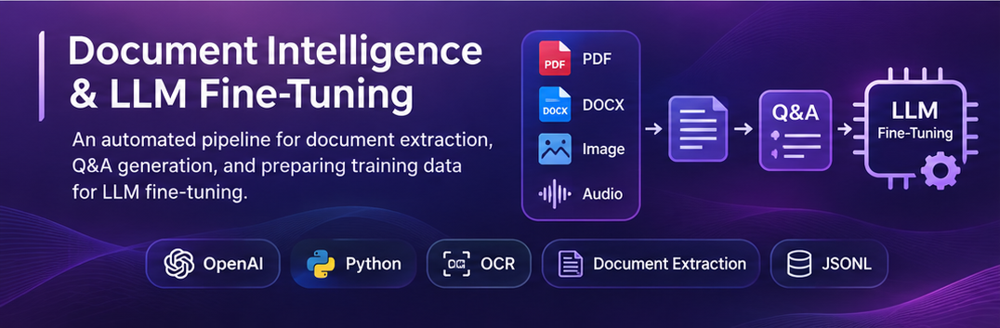
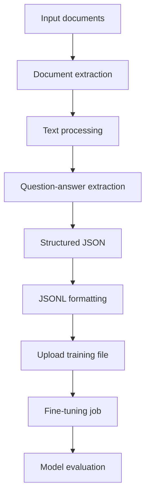

# Credit Document Processing & Fine-Tuning Pipeline




A Python pipeline for processing source documents, extracting question-answer pairs, formatting training data, and submitting a JSONL dataset to an OpenAI fine-tuning workflow.

## Pipeline



## What is included

- Extractor modules for audio, DOCX, images, PDF, and text.
- Folder-processing workflow.
- Question-answer extraction.
- JSON and JSONL formatting utilities.
- OpenAI file-upload and fine-tuning integration.
- Model/evolution testing scripts.
- Configuration module and main pipeline entry point.

## Repository layout

```text
.
├── config/
│   └── settings.py
├── extractors/
│   ├── audio_extractor.py
│   ├── docx_extractor.py
│   ├── image_extractor.py
│   ├── pdf_extractor.py
│   └── text_extractor.py
├── models/
│   └── fine_tuning.py
├── processing/
│   ├── folder_processor.py
│   ├── json_formatter.py
│   └── qa_extractor.py
├── main.py
├── Model_testing.py
├── evolution_testing.py
├── requirement.txt
└── README.md
```

## Requirements

- Python
- OpenAI API access
- Python packages listed in `requirement.txt`
- Optional system dependencies required by the audio and OCR extractors (for example, Whisper/FFmpeg and Tesseract, depending on the selected input types)

## Setup

```bash
git clone https://github.com/<your-username>/credit-document-finetuning.git
cd credit-document-finetuning

python -m venv .venv
# Windows PowerShell:
.venv\\Scripts\\Activate.ps1
# macOS / Linux:
source .venv/bin/activate

python -m pip install --upgrade pip
pip install -r requirement.txt
```

Set `OPENAI_API_KEY` in your local environment. Do not hardcode credentials in source files.

## Run

Review `config/settings.py` to understand the expected input/output paths and model settings. Place only documents you are authorized to process into the configured input directory, then run:

```bash
python main.py
```

The main workflow calls the folder processor, extracts Q&A pairs, writes structured JSON/JSONL, uploads the training file, and starts a fine-tuning job.

## Data and privacy

The original archive contained private/source documents, call recordings, and generated training datasets. Those files are intentionally **not included** in this public repository. This keeps the repository focused on reusable pipeline code and avoids publishing potentially copyrighted material or personal/customer information.

Use:
- Synthetic sample documents.
- Public-domain or appropriately licensed material.
- Consented, anonymized recordings where audio is used.
- Carefully reviewed training examples with sensitive information removed.

## Important notes

- Review the fine-tuning API model and endpoint compatibility before running.
- Confirm that the JSONL records meet the provider's current schema.
- Add evaluation criteria and holdout data before relying on a fine-tuned model.
- This is a cleaned code snapshot; the pipeline has not been executed end-to-end as part of repository packaging.

## License

Add a license only after confirming you have rights to publish the source code.
